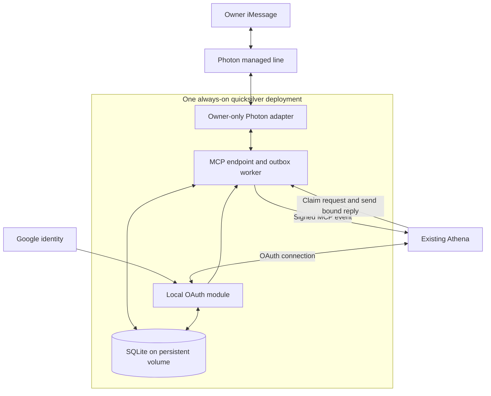

# quicksilver V1 Design

Design checkpoint: October 23, 2026. Build an owner-only, general-text iMessage channel into the existing Athena, independent of the owner’s Mac. Use one small always-on server with durable storage. Implementation is deferred; provider, budget and purchases remain undecided.

## Proven baseline

The October 15 proof completed one fixed-text exchange through Photon, quicksilver and the existing Athena, with owner-confirmed receipt. It was then parked with messaging and the temporary automation disabled. The proof used Render Free, Auth0 and in-memory state; it did not establish general conversation or durable recovery. [Proof record](https://github.com/alextuan1024/quicksilver/blob/main/PHOTON_TEST.md)

## Target architecture

One Node process contains separate transport, OAuth, MCP and worker modules. SQLite supplies the queue and durable state. No second AI, Redis, microservices or user-facing dashboard is needed.

## Authentication

Replace Auth0 with a mature OAuth module in the same deployment, subject to compatibility testing; no library is selected yet. Google remains the upstream identity provider. Removing Auth0 does not mean storing Google passwords or building a password system.

Pin the verified owner and MCP client. Preserve PKCE, exact redirect validation, audience and scope checks, secure signing-key management, and refresh-token rotation/revocation. OAuth grants must survive restart. MCP permits colocated authorization and resource servers. [Authorization specification](https://modelcontextprotocol.io/specification/2026-07-28/basic/authorization)

## Message handling

1. Accept only plain text from the verified owner’s exact Photon DM. Reject groups, echoes, media and unsupported events.

2. Atomically deduplicate and persist the inbound request, provider checkpoint and event-outbox entry.

3. Deliver a signed MCP event with a stable request ID. Athena claims the request through an authenticated tool and reads its text. Duplicate claims must not restart already-claimed work.

4. Athena uses its existing context and tools. Gmail, calendar and feeding-log examples remain Athena tasks, not backend modules.

5. Store each progress or final response in the reply outbox. The reply tool takes request ID, response ID, text and final status, never an arbitrary recipient. A final response closes the request.

Persistent records cover OAuth grants, subscriptions/signing material, requests/checkpoints, event outbox and reply outbox. Serialize initial request handling; delayed results stay tied to their originating request.

## State and failure rules

Request: received → persisted → event pending → event acknowledged → claimed → completed. Failed or uncertain processing becomes stalled and visible, not silently discarded. A webhook acknowledgment means receipt, not Athena completion.

Reply: queued → send attempted → provider accepted, or unknown outcome. Persist the attempt before the provider call. Repeated response IDs return the existing outcome. Provider acceptance is not proof of recipient delivery.

After a timeout or crash around sending, reconcile using a stable provider identifier and verified lookup/idempotency semantics. If the outcome cannot be established, require owner verification before another send. Never blindly resend or automatically rerun uncertain Athena actions. No exactly-once guarantee is claimed.

## Recovery and operations

Persist subscriptions across restarts; renew expiry and rotate signing secrets. Retry transient webhook failures with bounded backoff, the same event ID and fresh signatures. Support replay cursors without skipping pending events. [MCP Events](https://developers.openai.com/plugins/build/mcp-events)

Reconnect Photon and recover missed events only after verifying owner-scoped replay for the actual shared line and pinned SDK. Current Photon documentation describes sequence-based catch-up, but compatibility, retention and filtering remain acceptance gates. Never broaden to unrelated chats for recovery. [Photon events](https://photon.codes/docs/advanced-kits/imessage/events)

Provide health status, a pause switch, encrypted backups and restore testing. Log operational status and sanitized error categories only, never inbound payloads, reply text, tokens or raw provider errors. SQLite and backups contain private content and require restricted access and a retention policy.

## Scope and acceptance

V1 supports general owner text, request-bound progress and delayed results, and continuity with this Athena. Exclude unsolicited iMessages, standalone reminders, groups, media and arbitrary recipients. Existing action-confirmation rules still apply; authenticated message content is not a system instruction.

Before launch, test:

- Owner rejection, scope checks and OAuth renewal/revocation.

- General exchanges and context continuity with the Mac off.

- Duplicate and out-of-order events without duplicate actions or replies.

- Restart during persistence, webhook delivery, claiming and sending.

- Subscription renewal, Photon catch-up and explicitly reported recovery gaps.

- Unknown-send reconciliation, pause behavior and backup restoration.

## Decisions before implementation

- Hosting provider, monthly ceiling, persistent volume and backup destination. A small always-on server is selected in principle; no purchase is authorized.

- OAuth library and ChatGPT client compatibility.

- Content retention, backup retention and deletion policy.

- Owner-scoped Photon replay, cursor semantics and retention.

- Send reconciliation/idempotency guarantees and stalled-request recovery.

Render Free is unsuitable for the proposed local durable store because its filesystem is ephemeral and persistent disks are unavailable. [Render limits](https://render.com/docs/free)
