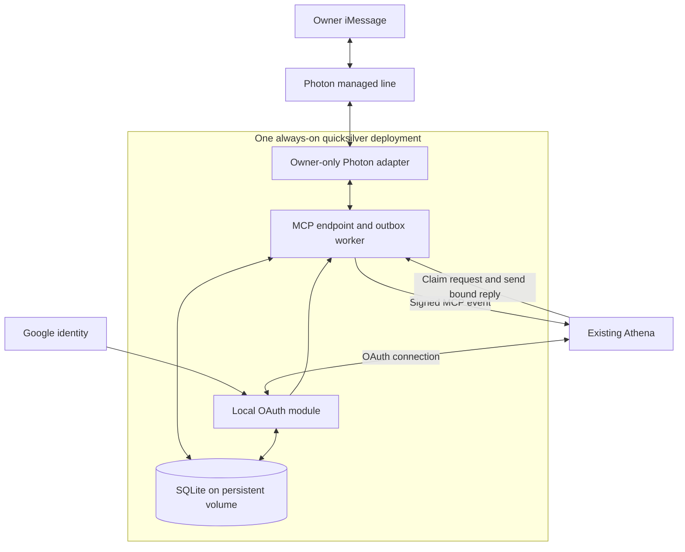

# quicksilver V1: Architecture and authentication

[Design overview](../design-v1.md) · Design checkpoint: October 23, 2026.

## Target architecture

One Node process contains separate transport, OAuth, MCP and worker modules. SQLite supplies the queue and durable state. No second AI, Redis, microservices or user-facing dashboard is needed.

## Authentication

Replace Auth0 with a mature OAuth module in the same deployment, subject to compatibility testing; no library is selected yet. Google remains the upstream identity provider. Removing Auth0 does not mean storing Google passwords or building a password system.

Pin the verified owner and MCP client. Preserve PKCE, exact redirect validation, audience and scope checks, secure signing-key management, and refresh-token rotation/revocation. OAuth grants must survive restart. MCP permits colocated authorization and resource servers. [Authorization specification](https://modelcontextprotocol.io/specification/2026-07-28/basic/authorization)
