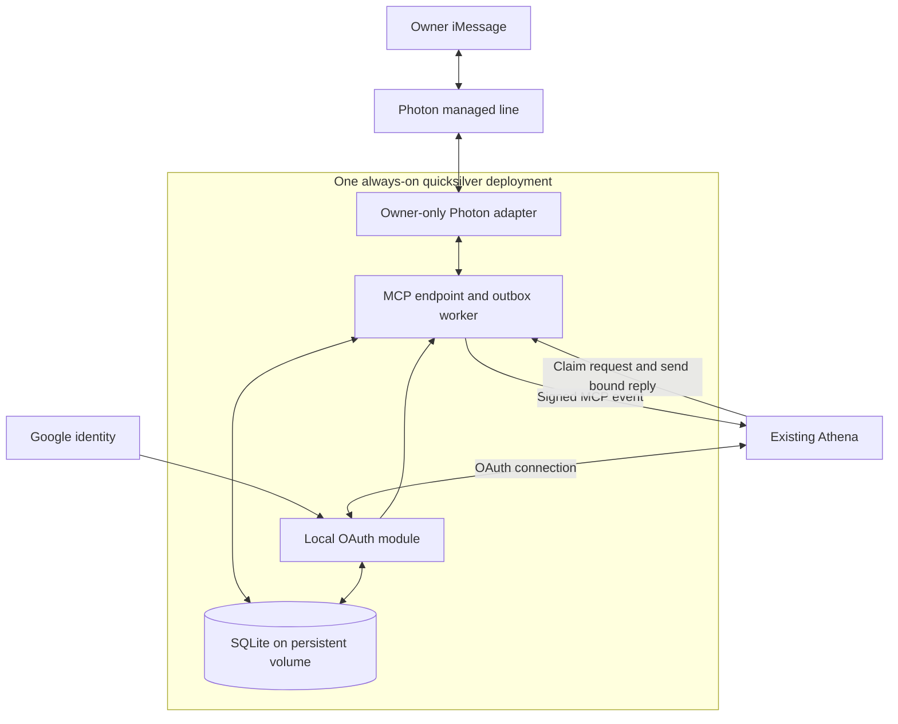

# quicksilver V1: Architecture and authentication

[Design overview](../design-v1.md) · Design checkpoint: October 23, 2026.

## Target architecture

One Node process contains separate transport, OAuth, MCP and worker modules. SQLite supplies the queue and durable state. No second AI, Redis, microservices or user-facing dashboard is needed.

## Authentication

Replace Auth0 with a mature OAuth module in the same deployment, subject to compatibility testing. The local implementation now uses
`oidc-provider` 9.13.0 with `openid-client` 6.8.8 for Google sign-in. Google remains the upstream identity provider. Removing Auth0 does not mean storing Google passwords or building a password system.

Pin the verified owner and MCP client. Preserve PKCE, exact redirect validation, audience and scope checks, secure signing-key management, and refresh-token rotation/revocation. OAuth grants must survive restart. MCP permits colocated authorization and resource servers. [Authorization specification](https://modelcontextprotocol.io/specification/2026-07-28/basic/authorization)

## Local implementation status (October 25, 2026)

The optional [local OAuth module](../local-oauth.md) implements pinned owner/client
authorization, durable SQLite grants, S256 PKCE, rotating refresh tokens and
revocation. Trusted composition connects it to the existing message component.
OAuth state uses a separate private SQLite file in the same deployment so message
backup restoration cannot automatically restore authorization grants.

The parked Auth0 runtime is unchanged. Live Google/ChatGPT acceptance, credential
provisioning, production activation policy, automated key operations and an
Auth0-to-Google message-store identity migration remain separate work.
